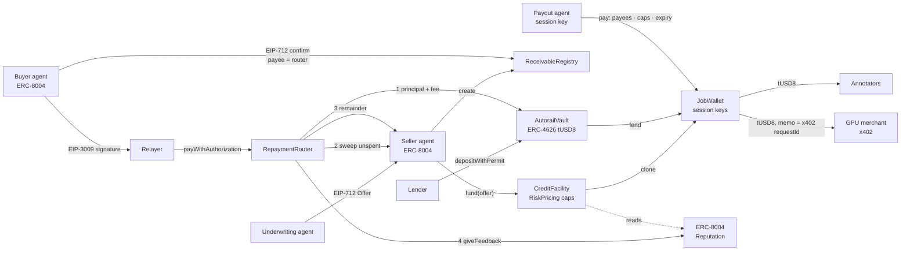

# Autorail contracts · QDay Aevum testnet

**Working capital for the vendors who train frontier AI.** AI data vendors (annotation, eval and RL-environment shops in India, Southeast Asia and Latin America) pay annotators and GPU bills weekly, but labs pay 30–90 days later. Autorail turns a **lab-confirmed invoice** into tUSD8 working capital today. The money can only be spent by **scoped agent session keys** on approved annotators and GPU merchants, and the lab's single gasless payment **repays lenders first**, in one transaction on Aevum. Every repayment is written to **ERC-8004 reputation**, so the next advance is priced on real history.

> Testnet only. tUSD8 and tQDAY are test assets with no monetary value. Contracts are unaudited. Built for the QDay Aevum Builder Challenge #1, entirely inside the build window.

## Architecture



## Deployment (Aevum testnet, chain 44005)

**Live.** Deployed 2026-11-21 at block **3,753,316** from commit
[`957edabb`](https://github.com/CodeBlocker52/AutoRail/tree/957edabb16d5141723b90695c411987bd02858f3) (clean tree; branch `feat/contracts`).
Full record: [`deployments/44005.json`](deployments/44005.json) (addresses, deploy txs, constructor args, compiler, OpenZeppelin, commit).

| Contract | Address | Deploy tx |
|---|---|---|
| AutorailVault | [`0xB8Faa056855Ad06ecE0e5C0812653D52FcBCa417`](https://explorer-test.qday.info/address/0xB8Faa056855Ad06ecE0e5C0812653D52FcBCa417) | [`0x3e5e5851…339965`](https://explorer-test.qday.info/tx/0x3e5e585112f1a0c1425a4e9c784b8f4f7ac44af0f9c6f7c3a2e4632d8c339965) |
| ReceivableRegistry | [`0x7BB5AAEf016174ac24898938fd74F245c7f02F81`](https://explorer-test.qday.info/address/0x7BB5AAEf016174ac24898938fd74F245c7f02F81) | [`0x3e4d7323…9267e3`](https://explorer-test.qday.info/tx/0x3e4d7323073bc64279000c2638995cabcc20debe1155a3021d7a34cb3d9267e3) |
| CreditFacility | [`0x5a5a830d038351E7fa38dD6b6D116f5b5C267E42`](https://explorer-test.qday.info/address/0x5a5a830d038351E7fa38dD6b6D116f5b5C267E42) | [`0xceff2bdf…bced15`](https://explorer-test.qday.info/tx/0xceff2bdf7aad32ca8815ba446eec59d8904960f17666deb7b2abacd67abced15) |
| JobWalletFactory | [`0xc66DB22D9E843d9587868881182B9A1a8d389f78`](https://explorer-test.qday.info/address/0xc66DB22D9E843d9587868881182B9A1a8d389f78) | [`0x059aaaab…3806e9`](https://explorer-test.qday.info/tx/0x059aaaab4a82fc5f25160c377c79edabbed990e016588c75d926c774cc3806e9) |
| JobWalletImplementation | [`0x12efA521A148dbcBa234f9cD52E41b63A0D16959`](https://explorer-test.qday.info/address/0x12efA521A148dbcBa234f9cD52E41b63A0D16959) | [`0xb17c130e…4dbecf`](https://explorer-test.qday.info/tx/0xb17c130e4bd5c2a9ff11abfc84be367c3f90589842d1d60096a852cff24dbecf) |
| RepaymentRouter | [`0x9857f243990Df645bdf43F165188DFFE162D40C7`](https://explorer-test.qday.info/address/0x9857f243990Df645bdf43F165188DFFE162D40C7) | [`0x7da2149a…116483`](https://explorer-test.qday.info/tx/0x7da2149a05e88a66b8203c63cc6b5d5c1047d286a7a3c37c721ed1811c116483) |
| AutorailRoles | [`0xb011da7b39C6cB038E1a01E0c114305551d76AA9`](https://explorer-test.qday.info/address/0xb011da7b39C6cB038E1a01E0c114305551d76AA9) | [`0xc2b1b64f…6cc401`](https://explorer-test.qday.info/tx/0xc2b1b64faa03ec134f5fbc5be041d59b95836e715196c0feeacf6665a16cc401) |
| IdentityRegistry | [`0x77D46b3fe9eD78c914280f22C0c57c330695B5E1`](https://explorer-test.qday.info/address/0x77D46b3fe9eD78c914280f22C0c57c330695B5E1) | [`0x85867e51…b1db93`](https://explorer-test.qday.info/tx/0x85867e51d58cf87ad247d027d0014e0982f3e4d30097981afca95d1e14b1db93) |
| ReputationRegistry | [`0xD9d57E96dbaec2Eb6956f29F6161E66A3e46a361`](https://explorer-test.qday.info/address/0xD9d57E96dbaec2Eb6956f29F6161E66A3e46a361) | [`0x8aee95ad…1eaa1a`](https://explorer-test.qday.info/tx/0x8aee95ad65c09de903a28e28f82c1067c32bcc345204507e599b30baf01eaa1a) |
| IdentityRegistryImpl | [`0x48394936dcf8783a75A695Fb76818F1a18Bbe716`](https://explorer-test.qday.info/address/0x48394936dcf8783a75A695Fb76818F1a18Bbe716) | [`0x85256b2d…509cf7`](https://explorer-test.qday.info/tx/0x85256b2d38c9873285a914331c64543dfe925e0b0408141cc79d8c996f509cf7) |
| ReputationRegistryImpl | [`0x95FDEFE46dAe522d744f90cF068Cf2Dd32fa6E2c`](https://explorer-test.qday.info/address/0x95FDEFE46dAe522d744f90cF068Cf2Dd32fa6E2c) | [`0x420b5151…676bc1`](https://explorer-test.qday.info/tx/0x420b5151264597dd0195f4353d21f93464fa8c13fdf5f0a42ae09e2ad5676bc1) |
| ERC8004Bootstrap | [`0x4490448d9F1EC9E656EaAdcBcC5A8D8DB06e6b2A`](https://explorer-test.qday.info/address/0x4490448d9F1EC9E656EaAdcBcC5A8D8DB06e6b2A) | [`0x8f60142a…e150ac`](https://explorer-test.qday.info/tx/0x8f60142af110faf8bf690217c33cf39a5e2d339925082dfd5826fe03e5e150ac) |
| tUSD8 (existing) | [`0x456569838f1d43009A91ebA4263147Afd7233483`](https://explorer-test.qday.info/address/0x456569838f1d43009A91ebA4263147Afd7233483) | — |

Explorer **source verification is down** on Aevum (command ready in `docs/CHAIN.md`). Instead, `make check-deployment` proves the deployment over RPC, **55/55 checks**:
- code at every address, the vault asset, every wiring address, owners, the 5 agents' owners and roles, and the buyer tier
- both ERC-8004 proxies point at implementations whose **runtime bytecode byte-matches the compiled official ERC-8004 source** (immutables masked), and their `owner()` is the admin

ERC-8004 agents: `lumen-data` #0 (Seller), `frontier-lab` #1 (Buyer, tier 1), `underwriter` #2, `payout` #3, `kestrel-gpu` #4 (Merchant). Each has a fully onchain `data:` agentURI.

### Key transactions from the live demo
Receivable `0x345bd6f6…7281` · JobWallet [`0x23b164831b7E5b1b610992902b8130D78a3BEe49`](https://explorer-test.qday.info/address/0x23b164831b7E5b1b610992902b8130D78a3BEe49). All 15 step records (actor, amounts, tx, decoded error, balances after each step) are in [`deployments/demo-run-44005.json`](deployments/demo-run-44005.json).

| # | Step | Tx |
|---|---|---|
| 1 | Lender deposits 1.20 (EIP-2612 permit) | [`0xcabc0d30…698529`](https://explorer-test.qday.info/tx/0xcabc0d30a4a2450bfaf6f2f4114d770042214beb6b506c153fe713bd13698529) |
| 2 | Buyer confirms INV-001 (EIP-712, payee = router) | [`0x40015230…bd2aeb`](https://explorer-test.qday.info/tx/0x4001523066c4e201cb3fe29bd25200dc58d77451e3bb894853003fe5f2bd2aeb) |
| 3 | Seller funds the 1.20 advance (underwriter offer) | [`0xe00cef33…6d2fa1`](https://explorer-test.qday.info/tx/0xe00cef330cd0e858da0e59ef2af13e9ed6c6739346de33e96e18892e5a6d2fa1) |
| 4 | Payout agent pays Annotator A 0.40 | [`0xe3c800eb…faea71`](https://explorer-test.qday.info/tx/0xe3c800ebf1f02a0f50853bd069810857f6635469cf8dff12c9e8bad13bfaea71) |
| 5 | Payout agent pays Annotator B 0.40 | [`0x0e7f54bc…3054d1`](https://explorer-test.qday.info/tx/0x0e7f54bcf5aa08647092a8eb25bbb255fcc220ce2bc7cd86c94ec060623054d1) |
| 6 | Payout agent pays GPU merchant 0.30 (x402 requestId memo) | [`0x8a5d2536…476791`](https://explorer-test.qday.info/tx/0x8a5d253601d4379895343217e8afd7ee70140efd90e739f6e5b09e8599476791) |
| 7 | **Blocked**: prompt-injected 0.05 → 0xBAD… · `PayeeNotAllowed` | [`0xbb605e3c…312c7d`](https://explorer-test.qday.info/tx/0xbb605e3c3e9b1430f802519fe3eb174a93a53ac6dfbf16692b3356dde6312c7d) |
| 8 | **Blocked**: 0.60 over the 0.50 cap · `OverPerTxCap` | [`0x3f1c6f99…ed4252`](https://explorer-test.qday.info/tx/0x3f1c6f9997c8f456e266b348d3424bb07788e717e52b5db9d000fd2dcbed4252) |
| 9 | Seller revokes the session | [`0x30ebc3e1…8a8458`](https://explorer-test.qday.info/tx/0x30ebc3e1a9e559711530bcc5ef833a1be6aefbedc43e7dc0f13e3521978a8458) |
| 10 | **Blocked**: retry after revoke · `SessionRevoked` | [`0x32aa8479…ad5469`](https://explorer-test.qday.info/tx/0x32aa8479bea73dd5256ebca64d70b396589a8e68ab4bb9569f47dac969ad5469) |
| 11 | Lab pays 1.60 gaslessly (EIP-3009 via relayer): vault +1.224, seller +0.376 +0.10 swept, ERC-8004 `NewFeedback` 100 in the same tx | [`0x3473284f…74ff01`](https://explorer-test.qday.info/tx/0x3473284f084d95f4f4a63a6062b90114f2d4583712df95eca7ddf3053c74ff01) |

The three blocked attempts are **real mined transactions** with status `reverted`; the custom error is decoded with `eth_call`. Total gas for the demo run: 0.00215 tQDAY.

## How each technology is used

| Technology | Where |
|---|---|
| **tUSD8 EIP-2612 permit** | `AutorailVault.depositWithPermit`: one signature + one tx, front-run-safe |
| **tUSD8 EIP-3009** | `RepaymentRouter.payWithAuthorization` uses `receiveWithAuthorization` (can't be front-run into a plain transfer) with a **receivable-bound nonce** `keccak256(router, id)`, and the **amount must equal the invoice** onchain. A relayer pays the gas |
| **ERC-8004 Identity** | Official registry deployed by us (no official Aevum deployment). All 5 agents register with fully onchain `data:` URIs; `AutorailRoles` maps agent ids to roles, checked live against the NFT owner or agent wallet |
| **ERC-8004 Reputation** | The router writes `giveFeedback(seller, 100 on time / 50 late, tag "credit")`; the facility writes 0 on default; the underwriter reads `getSummary` |
| **ERC-4626** | `AutorailVault`: `totalAssets = idle + outstanding`, decimals offset 6 + dead shares against inflation, withdrawals capped at idle |
| **EIP-712** | Buyer `Confirmation` (payee pinned to the router) and underwriter `Offer` (advance, fee, payee list, expiry, nonce) |
| **Session keys** | `JobWallet`: approved payees, per-payment cap, total cap, expiry, instant revoke. Checks in order: `SessionRevoked → SessionExpired → PayeeNotAllowed → OverPerTxCap → OverTotalCap` |
| **x402-style payments** | Merchant answers HTTP 402 with a tUSD8 price and request id; the agent pays from the JobWallet with `memo = requestId`; the merchant verifies the `Paid` event on Aevum and returns 200. Settles on Aevum only |
| **Shanghai EVM** | `evm_version = "shanghai"`, no transient storage or MCOPY, Shanghai-safe signature checker, bytecode scan in `make build`, onchain PUSH0 probe |

## Contracts

| Contract | Role |
|---|---|
| `AutorailRoles` | agentId → role (Seller, Buyer, Underwriter, Payout, Merchant), buyer tier 1–3 |
| `AutorailVault` | ERC-4626 lender vault; `lend`/`writeOff` (facility), `repay` (router) |
| `ReceivableRegistry` | invoices, EIP-712 confirmation, dedupe, self-dealing check, state machine |
| `CreditFacility` | verifies underwriter offers against `RiskPricing`, deploys JobWallets, credit records, permissionless overdue/default |
| `JobWallet` + `JobWalletFactory` | per-invoice wallet (EIP-1167 clone) with scoped session keys |
| `RepaymentRouter` | gasless repayment and the lenders-first waterfall in one tx, plus ERC-8004 feedback |
| `RiskPricing` (library) | band A/B/C/D → max advance 80/75/60/0%, fee floor 1.5/2/3%, seller limit 1.50 + 0.50 per on-time repayment |
| `src/erc8004/*` | official ERC-8004 Identity + Reputation (unmodified) behind ERC1967 proxies |

## Tests

Toolchain is pinned: **Foundry `forge 1.10.0` (commit `083e2299`)**, solc 0.8.24, EVM shanghai. CI installs exactly this version.

| Command | Output (exact) | What it covers |
|---|---|---|
| `forge test` (= `make test`, no RPC) | **118 passed, 0 failed, 1 skipped (119 total)** | 117 unit/fuzz/demo tests + the invariant suite (6 invariants, which Foundry counts as 1). The 1 skipped is the fork suite, which skips itself without `--fork-url` |
| `make test-fork` (`--fork-url` Aevum) | **4 passed** | real tUSD8: domain separator, permit deposit, full repayment via `receiveWithAuthorization`, FiatToken check order |
| `make coverage` | **97.88% lines** on `src/` (vendored ERC-8004 excluded) | |

Highlights: `test/Demo.t.sol` (the 12-step scenario with balance checks after every step), waterfall-conservation and session-cap fuzzing, 6 invariants, signature replay / chain ID / payee / expiry / signer / nonce-binding tests, the tUSD8 check order (payee → time window → nonce → signature) on both the mock and the real token, and reentrancy through a hostile token.

Tests keep time in a storage `clock` (`Base._warp`) and never reuse a `block.timestamp`-derived value across `vm.warp`. TIMESTAMP is constant within a transaction, so the via-IR optimizer may legally re-materialize such an expression after a warp, and the result then depends on the build (see PROGRESS.md, "Test fix: warp vs re-materialized TIMESTAMP").

## Run it

```bash
cd contracts
make install            # forge libs (foundry.lock) + script deps
make build              # compile + Shanghai bytecode check
make test               # 118 passed, 1 skipped (fork suite)
make test-fork          # real tUSD8 on a fork, no funds needed

# free rehearsal on a local Aevum copy (chain 440050)
make fork               # terminal 1
make rehearse           # terminal 2: fund → deploy → register agents → 12-step e2e

# Aevum testnet
cp .env.example .env    # fill keys (or use ACCOUNT=<foundry keystore>)
make fund-aevum deploy-aevum register-agents-aevum check-deployment e2e-aevum
make recycle-aevum      # optional: sweep demo funds back
```

The e2e (`scripts/e2e/run.ts`) is resumable: progress goes to `deployments/demo-run-<chainId>.json` after every tx, each tx hash is saved **before** broadcast (a rerun never pays twice), RPC errors are retried with backoff (reverts never are), and blocked steps are real mined reverts decoded with `eth_call`.

## Environment

| Variable | Purpose |
|---|---|
| `DEPLOYER_PRIVATE_KEY` / `ACCOUNT` | deployer (raw key, or Foundry keystore name) |
| `ADMIN_ADDRESS` | Ownable2Step owner (defaults to the deployer) |
| `UNDERWRITER_PRIVATE_KEY` | signs funding offers |
| `RELAYER_PRIVATE_KEY` | submits gasless payments |
| `LENDER_PRIVATE_KEY`, `SELLER_PRIVATE_KEY`, `BUYER_PRIVATE_KEY` | demo actors |
| `PAYOUT_SESSION_PRIVATE_KEY`, `MERCHANT_PRIVATE_KEY` | payout session key, x402 merchant |
| `ANNOTATOR_A/B_PRIVATE_KEY`, `ROGUE_PRIVATE_KEY` | payees (the rogue is never approved) |
| `AEVUM_RPC_URL`, `FORK_RPC_URL` | RPC endpoints |

Addresses are in `docs/ACCOUNTS.md`. Chain facts are in `docs/CHAIN.md`.

## Known limits

Explorer verification is down on Aevum (RPC proof instead). The underwriter key is trusted to price within onchain bounds. There's a single-EOA admin and no timelock (testnet). Amounts are testnet-sized (tUSD8 is scarce). tUSD8 is a FiatToken (issuer can pause or blacklist). Details are in `docs/SECURITY.md`.

## Roadmap

Multisig + timelock admin · underwriter quorum or attestations · Aevum native smart accounts and session keys when the bundler ships · fiat payouts · real lab onboarding and legal wrapper · QDay mainnet (chain ID 44002, per the official [developer guide](https://wiki.qday.info/Knowledge/technical/developer-guide/smart-contract-development/); parameters published at launch).

## Licences and credits

MIT. Uses OpenZeppelin Contracts 5.4 and forge-std. The ERC-8004 registries are the official MIT implementation (unmodified). Parts are based on the **Aevum Starter Kit (MIT, PQA Labs)**: the EIP-3009 `Checkout` pattern, `MockUSD8`, the Shanghai checker, the fork/deal Makefile targets, the relayer rails and the `@aevum-kit/aevum` helpers. See `NOTICE.md`.
