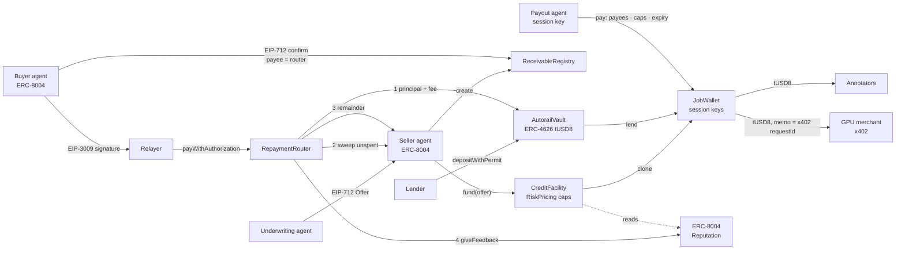

# Autorail contracts · QDay Aevum testnet

**Working capital for the vendors who train frontier AI.** AI data vendors (annotation, eval and RL-environment shops in India, Southeast Asia and Latin America) pay annotators and GPU bills weekly, but labs pay 30–90 days later. Autorail turns a **lab-confirmed invoice** into tUSD8 working capital today. The money can only be spent by **scoped agent session keys** on approved annotators and GPU merchants, and the lab's single gasless payment **repays lenders first**, in one transaction on Aevum. Every repayment is written to **ERC-8004 reputation**, so the next advance is priced on real history.

> Testnet only. tUSD8 and tQDAY are test assets with no monetary value. Contracts are unaudited. Built for the QDay Aevum Builder Challenge #1, entirely inside the build window.

## Architecture



## Deployment (Aevum testnet, chain 44005)

> **Status:** ready to deploy. Rehearsed twice end to end on a local Aevum fork. Waiting on tUSD8 funding (see `docs/OPEN_QUESTIONS.md` Q1). This table is generated from `deployments/44005.json` after `make deploy-aevum`.

| Contract | Address | Deploy tx |
|---|---|---|
| _pending_ | | |

Source commit: _pending_ · Explorer source verification is down on Aevum; the command is ready in `docs/CHAIN.md`. Until then, `make check-deployment` proves code, wiring, roles and agents over RPC.

### Key transactions from the live demo
_pending (from `deployments/demo-run-44005.json`): deposit, confirm, fund, 3 payments, 3 blocked attempts (`PayeeNotAllowed`, `OverPerTxCap`, `SessionRevoked`), the gasless repayment and the ERC-8004 feedback._

## How each technology is used

| Technology | Where |
|---|---|
| **tUSD8 EIP-2612 permit** | `AutorailVault.depositWithPermit`: one signature + one tx, front-run-safe |
| **tUSD8 EIP-3009** | `RepaymentRouter.payWithAuthorization` uses `receiveWithAuthorization` (can't be front-run into a plain transfer) with a **receivable-bound nonce** `keccak256(router, id)`, and the **amount must equal the invoice** onchain. A relayer pays the gas |
| **ERC-8004 Identity** | Official registry deployed by us (no official Aevum deployment). All 5 agents register with fully onchain `data:` URIs; `AutorailRoles` maps agent ids to roles, checked live against the NFT owner or agent wallet |
| **ERC-8004 Reputation** | The router writes `giveFeedback(seller, 100 on time / 50 late, tag "credit")`; the facility writes 0 on default; the underwriter reads `getSummary` |
| **ERC-4626** | `AutorailVault`: `totalAssets = idle + outstanding`, decimals offset 6 + dead shares against inflation, withdrawals capped at idle |
| **EIP-712** | Buyer `Confirmation` (payee pinned to the router) and underwriter `Offer` (advance, fee, payee list, expiry, nonce) |
| **Session keys** | `JobWallet`: approved payees, per-payment cap, total cap, expiry, instant revoke. Checks in order: `SessionRevoked → SessionExpired → PayeeNotAllowed → OverPerTxCap → OverTotalCap` |
| **x402-style payments** | Merchant answers HTTP 402 with a tUSD8 price and request id; the agent pays from the JobWallet with `memo = requestId`; the merchant verifies the `Paid` event on Aevum and returns 200. Settles on Aevum only |
| **Shanghai EVM** | `evm_version = "shanghai"`, no transient storage or MCOPY, Shanghai-safe signature checker, bytecode scan in `make build`, onchain PUSH0 probe |

## Contracts

| Contract | Role |
|---|---|
| `AutorailRoles` | agentId → role (Seller, Buyer, Underwriter, Payout, Merchant), buyer tier 1–3 |
| `AutorailVault` | ERC-4626 lender vault; `lend`/`writeOff` (facility), `repay` (router) |
| `ReceivableRegistry` | invoices, EIP-712 confirmation, dedupe, self-dealing check, state machine |
| `CreditFacility` | verifies underwriter offers against `RiskPricing`, deploys JobWallets, credit records, permissionless overdue/default |
| `JobWallet` + `JobWalletFactory` | per-invoice wallet (EIP-1167 clone) with scoped session keys |
| `RepaymentRouter` | gasless repayment and the lenders-first waterfall in one tx, plus ERC-8004 feedback |
| `RiskPricing` (library) | band A/B/C/D → max advance 80/75/60/0%, fee floor 1.5/2/3%, seller limit 1.50 + 0.50 per on-time repayment |
| `src/erc8004/*` | official ERC-8004 Identity + Reputation (unmodified) behind ERC1967 proxies |

## Tests

| Suite | Count |
|---|---|
| Unit, fuzz and demo tests (`make test`) | **115 tests + 6 invariants** (Foundry prints "116 passed" because it reports the invariant suite as one) |
| Fork tests on the real tUSD8 (`make test-fork`) | **3** |
| Line coverage on `src/` (vendored ERC-8004 excluded, `make coverage`) | **97.8%** |

Highlights: `test/Demo.t.sol` (the 12-step scenario with balance checks after every step), waterfall-conservation and session-cap fuzzing, 6 invariants, signature replay / chain ID / payee / expiry / signer / nonce-binding tests, and reentrancy through a hostile token.

## Run it

```bash
cd contracts
make install            # forge libs (foundry.lock) + script deps
make build              # compile + Shanghai bytecode check
make test               # 115 tests + 6 invariants
make test-fork          # real tUSD8 on a fork, no funds needed

# free rehearsal on a local Aevum copy (chain 440050)
make fork               # terminal 1
make rehearse           # terminal 2: fund → deploy → register agents → 12-step e2e

# Aevum testnet
cp .env.example .env    # fill keys (or use ACCOUNT=<foundry keystore>)
make fund-aevum deploy-aevum register-agents-aevum check-deployment e2e-aevum
make recycle-aevum      # optional: sweep demo funds back
```

The e2e (`scripts/e2e/run.ts`) is resumable: progress goes to `deployments/demo-run-<chainId>.json` after every tx, each tx hash is saved **before** broadcast (a rerun never pays twice), RPC errors are retried with backoff (reverts never are), and blocked steps are real mined reverts decoded with `eth_call`.

## Environment

| Variable | Purpose |
|---|---|
| `DEPLOYER_PRIVATE_KEY` / `ACCOUNT` | deployer (raw key, or Foundry keystore name) |
| `ADMIN_ADDRESS` | Ownable2Step owner (defaults to the deployer) |
| `UNDERWRITER_PRIVATE_KEY` | signs funding offers |
| `RELAYER_PRIVATE_KEY` | submits gasless payments |
| `LENDER_PRIVATE_KEY`, `SELLER_PRIVATE_KEY`, `BUYER_PRIVATE_KEY` | demo actors |
| `PAYOUT_SESSION_PRIVATE_KEY`, `MERCHANT_PRIVATE_KEY` | payout session key, x402 merchant |
| `ANNOTATOR_A/B_PRIVATE_KEY`, `ROGUE_PRIVATE_KEY` | payees (the rogue is never approved) |
| `AEVUM_RPC_URL`, `FORK_RPC_URL` | RPC endpoints |

Addresses are in `docs/ACCOUNTS.md`. Chain facts are in `docs/CHAIN.md`.

## Known limits

Explorer verification is down on Aevum (RPC proof instead). The underwriter key is trusted to price within onchain bounds. There's a single-EOA admin and no timelock (testnet). Amounts are testnet-sized (tUSD8 is scarce). tUSD8 is a FiatToken (issuer can pause or blacklist). Details are in `docs/SECURITY.md`.

## Roadmap

Multisig + timelock admin · underwriter quorum or attestations · Aevum native smart accounts and session keys when the bundler ships · fiat payouts · real lab onboarding and legal wrapper · mainnet (chain 44002).

## Licences and credits

MIT. Uses OpenZeppelin Contracts 5.4 and forge-std. The ERC-8004 registries are the official MIT implementation (unmodified). Parts are based on the **Aevum Starter Kit (MIT, PQA Labs)**: the EIP-3009 `Checkout` pattern, `MockUSD8`, the Shanghai checker, the fork/deal Makefile targets, the relayer rails and the `@aevum-kit/aevum` helpers. See `NOTICE.md`.
